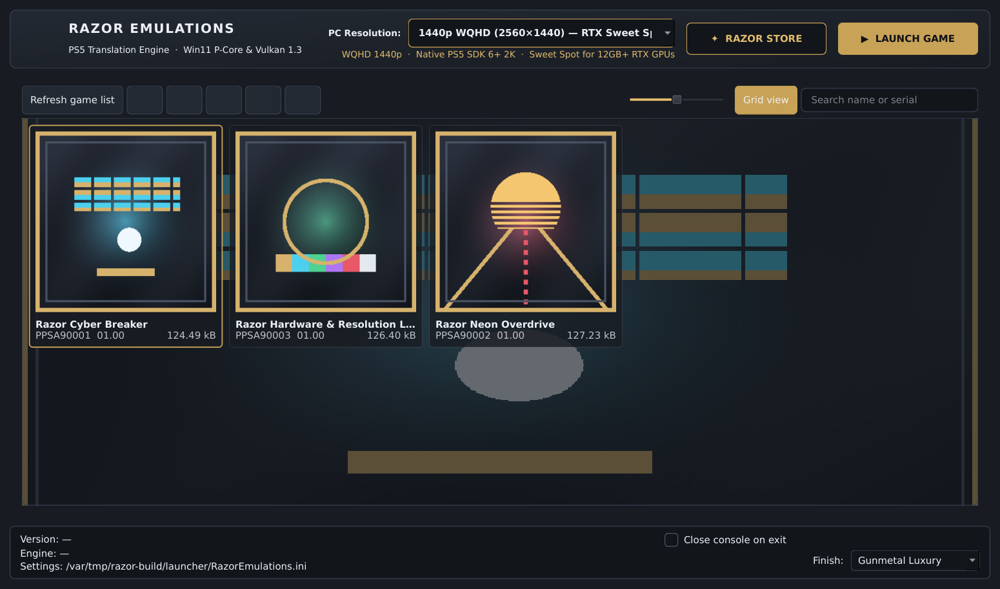
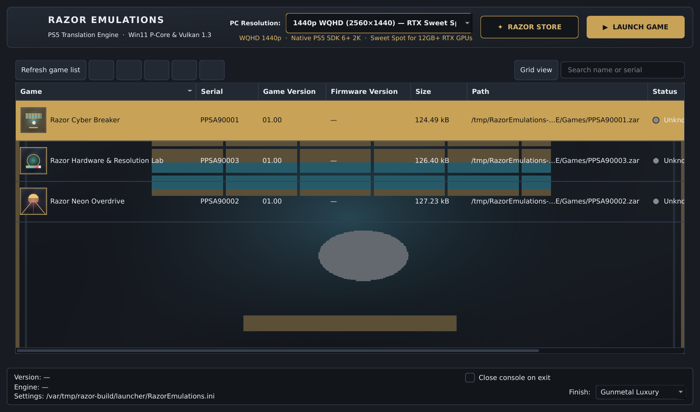
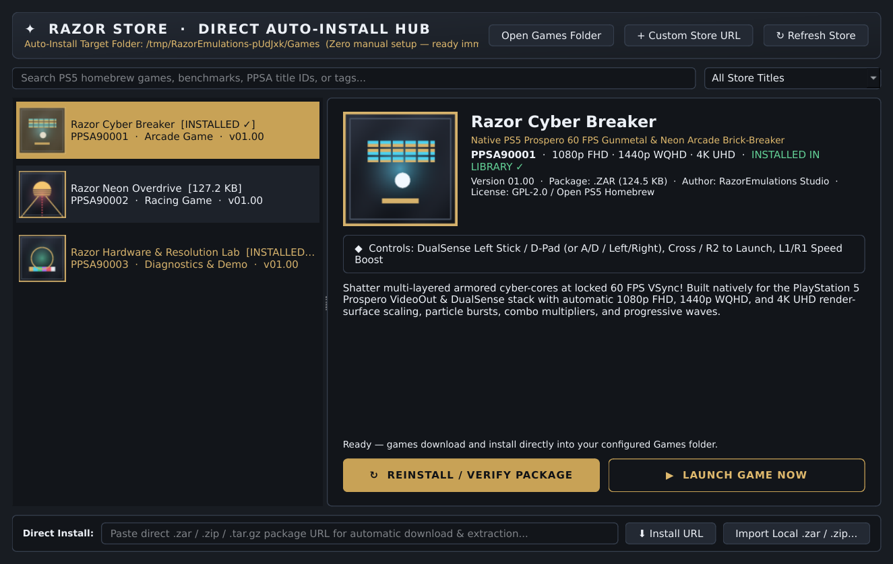

# RazorEmulations

**RazorEmulations** is an open-source PlayStation 5 translation layer and desktop suite written in C++20 and Vulkan 1.3 for **Windows 11 x64** (with Linux and experimental macOS support). Engineered for high-frequency hybrid desktop processors and discrete PC GPUs, it features a custom **Gunmetal Grey Luxury** Qt 6 command deck and native **PC Resolution Scaling (`1080p` FHD, `1440p` WQHD, `4K` UHD)**.





> **Legal Notice:** RazorEmulations is not affiliated with, endorsed by, or connected to Sony Interactive Entertainment LLC or PlayStation. No copyrighted firmware, BIOS, cryptographic keys, or commercial game files are included or distributed. Bundled Razor Store packages are 100% original open-source PS5 Prospero homebrew & hardware diagnostic titles. Use only legal homebrew or self-dumped backups of games you own.

---

## Key Engineering Highlights (Windows 11 Desktop Edition)

### 1. Native PC Target Resolution Control (`1080p` / `1440p` WQHD / `4K` UHD)
Unlike a physical PS5 console locked to television EDID handshakes, **RazorEmulations** exposes an instant **PC Resolution Selector** directly on the main launcher header and via `--output-resolution <1080p|1440p|4k|auto>`:
- **1080p FHD (`1920×1080` — Maximum Stability):** Forces `libSceVideoOut` (`sceVideoOutGetOutputStatus`) to report `SCE_VIDEO_OUT_OUTPUT_RESOLUTION_FHD` (`1u`) to the game engine. Titles built with Unreal Engine 4/5, Unity, and custom engines allocate 1080p G-buffers and render targets instead of 4K targets, saving **~2.5–3.5 GiB of VRAM** and dramatically improving frame stability on 12 GB GPUs.
- **1440p WQHD (`2560×1440` — RTX Sweet Spot):** Implements native PS5 SDK 6.0+ `sceVideoOutAllowOutputResolutionWqhdDetection` (`3u`) alongside a native `2560×1440` Vulkan swapchain—delivering sharp 2K output without 4K memory pressure.
- **4K UHD (`3840×2160` — Ultra Fidelity):** Full 4K UHD reporting (`2u`) and swapchain presentation, combinable with PS5 Pro (`--trinity`) + NVIDIA DLSS (`--pssr-upscaler DLSS`) or AMD FSR.

### 2. Intel Hybrid CPU Topology & Windows 11 Power Unthrottling (`i7-14700KF` Tuned)
- **P-Core Isolation (`src/common/threads.cpp`):** Reserves the highest-clocked Raptor Cove Performance Core exclusively for the Vulkan GPU submission thread (`THREAD_PRIORITY_HIGHEST`), while binding PS5 guest threads to the remaining **7 Performance Cores (14 threads)** on 8P+E hybrid CPUs (such as the **Intel Core i7-14700KF**). All 12 Gracemont Efficiency Cores remain free for Windows 11 DWM, audio mixing, and NVIDIA Vulkan driver background shader compilation—eliminating cross-cluster ring-bus spinlock stutter.
- **EcoQoS & Timer Occlusion Suppression:** Explicitly disables `PROCESS_POWER_THROTTLING_EXECUTION_SPEED` and `PROCESS_POWER_THROTTLING_IGNORE_TIMER_RESOLUTION` via Win32 `SetProcessInformation`, ensuring sub-millisecond waitable timer precision even in borderless or multi-monitor setups.
- **64-Shard Cache-Line-Aligned Address Sync (`src/kernel/syncOnAddress.cpp`):** Replaces global futex mutex contention with 64 cache-line-isolated shards and user-space `_mm_pause()` micro-handoffs.

### 3. 12 GB Discrete GPU VRAM Guardrails & Windows 11 Stability (`RTX 3080 Ti` + `32 GB RAM`)
- **Proactive Texture/Buffer GC Watermarks:** Calibrated for 12 GB GDDR6X GPUs (~10.5 GiB WDDM net budget) to evict stale cached textures before Windows 11 WDDM 3.x demotes active render targets across PCIe.
- **Graceful System-RAM Spillover (`vma.cpp`, `streamBuffer.cpp`):** Transient render-target or buffer bursts that exceed `VMA_ALLOCATION_CREATE_WITHIN_BUDGET_BIT` automatically retry across host-backed WDDM memory (utilizing 32 GB system RAM) instead of terminating the game.
- **First-Responder VEH Page Tracking (`hostException.cpp`):** Registers the GPU `PageManager` Vectored Exception Handler with `First = 1` ahead of Vulkan ICD (`nvoglv64.dll`), NVIDIA NGX/DLSS, and third-party overlays.
- **High-Address PE64 Base (`CMakeLists.txt`):** Anchors `clang-cl` / `lld-link` builds at `/BASE:0x100000000000` (16 TiB), keeping the host executable completely clear of all PS5 guest virtual address spaces.

### 4. Built-In Razor Store & Zero-Setup Auto-Installer (`✦ RAZOR STORE`)
- **Zero Manual Folder Configuration:** On first launch, `razor_launcher` automatically creates and registers a writable `Games/` library folder next to the emulator—no manual folder setup dialogs required.
- **Playable Native 60-FPS PS5 Prospero Homebrew & Diagnostics Included (`store/`):**
  - **`PPSA90001` — *Razor Cyber Breaker*:** Native PS5 Prospero 60 FPS VSync arcade brick-breaker with adaptive `1080p`/`1440p`/`4K` tiled surfaces, particle bursts, and DualSense controls.
  - **`PPSA90002` — *Razor Neon Overdrive*:** Native PS5 Prospero 60 FPS synthwave pseudo-3D highway racer with 360 KM/H Nitrous overdrive and shield pickups.
  - **`PPSA90003` — *Razor Hardware & Resolution Lab*:** Real-time `sceVideoOutGetOutputStatus` (`1080p` FHD / `1440p` WQHD / `4K` UHD) verifier, DualSense stick/trigger/lightbar visualizer, and 60 Hz frame-pacing suite.
- **Universal `.zar` / `.zip` / `.tar.gz` / `.elf` One-Click Installer:** Paste any direct package URL, import a local archive, or add your own Custom Store `catalog.json` URL (including a personal LAN/NAS vault powered by `.\store\host_private_store.ps1`). Razor Store verifies SHA-256 checksums, safely unwraps nested folders, places packages straight into `Games/`, and refreshes your library automatically.
- **No `PS5UPDATE.PUP` Required:** RazorEmulations uses High-Level Emulation (HLE) of PlayStation 5 system libraries (`libkernel`, `libSceVideoOut`, `libSceAgcDriver`, `libScePad`, `libSceAudioOut2`, `libSceUserService`, etc.) compiled directly into `razor_emulator`, so encrypted Sony `.PUP` firmware images are neither needed nor used.

### 5. Gunmetal Grey Luxury Desktop Interface
- Custom Qt 6 **Fusion** palette & stylesheet (`launcherTheme.cpp`, `launcher.qss`) crafted in brushed anodized gunmetal (`#12151A` / `#181C22` / `#232933`), platinum typography (`#ECF0F6`), and champagne-tungsten accents (`#C8A256`).
- Instant header **PC Resolution Selector**, live VRAM/stability telemetry hint, one-click **`✦ RAZOR STORE`** and **`▶ LAUNCH GAME`** action buttons, translucent gunmetal game cards over PS5 hero art (`pic0.png`), and DualSense lightbar preview.

---

## Building on Windows 11 (Recommended Reference Spec: i7-14700KF · 32 GB RAM · RTX 3080 Ti)

### Automated Cloud Build (Zero Local Setup)
Every push to `main` triggers `.github/workflows/build.yml`, which automatically builds **`RazorEmulations-YYYY-MM-DD-<sha>-Windows-x64.zip`** with Visual Studio Clang, LTO, and Qt 6, runs the CTest suite, and publishes a GitHub Release on your repository.

### Local Build Requirements
- **OS:** Windows 11 x64 (or Windows 10 1803+)
- **GPU:** Vulkan 1.3 capable GPU with latest Game Ready / Studio drivers (NVIDIA RTX 30/40/50 series or AMD RDNA 2+)
- **Tools:**
  - Git (with submodules: `git submodule update --init --recursive`)
  - CMake 3.19+ & Ninja
  - Visual Studio 2022 / 2026 Build Tools (**Desktop development with C++** + **C++ Clang tools for Windows**)
  - `glslangValidator` (via Vulkan SDK or `vcpkg install glslang[tools,opt]:x64-windows`)
  - Qt 6.8+ (`msvc2022_64` with `Concurrent`, `Network`, `Widgets`)

```bat
cmake -S . -B _Build/windows -G Ninja ^
  -DCMAKE_BUILD_TYPE=Release ^
  -DCMAKE_INTERPROCEDURAL_OPTIMIZATION=ON ^
  -DCMAKE_C_COMPILER=clang-cl ^
  -DCMAKE_CXX_COMPILER=clang-cl ^
  -DCMAKE_PREFIX_PATH="C:\Qt\6.10.3\msvc2022_64"

cmake --build _Build/windows --target launcher --parallel
cmake --install _Build/windows --prefix _Build/windows/install
```

---

## Running

Launch the Gunmetal Grey Luxury desktop suite:
```bat
.\_Build\windows\install\razor_launcher.exe
```

Or run a legally obtained PS5 game directory / `.zar` archive directly from CLI with a PC resolution preset:
```bat
.\_Build\windows\install\razor_emulator.exe --game "D:\PS5Games\ExampleGame" --screen-width 2560 --screen-height 1440 --output-resolution 1440p --shader-cache
```

---

## License & Upstream Credits
- Licensed under **GPL-2.0** (see [`LICENSE`](LICENSE) and [`LICENSES/Kyty-MIT.txt`](LICENSES/Kyty-MIT.txt)).
- Derived from [KytyPS5/KytyPS5](https://github.com/KytyPS5/KytyPS5) and [InoriRus/Kyty](https://github.com/InoriRus/Kyty), with architectural references from [shadps4-emu/shadPS4](https://github.com/shadps4-emu/shadPS4).
